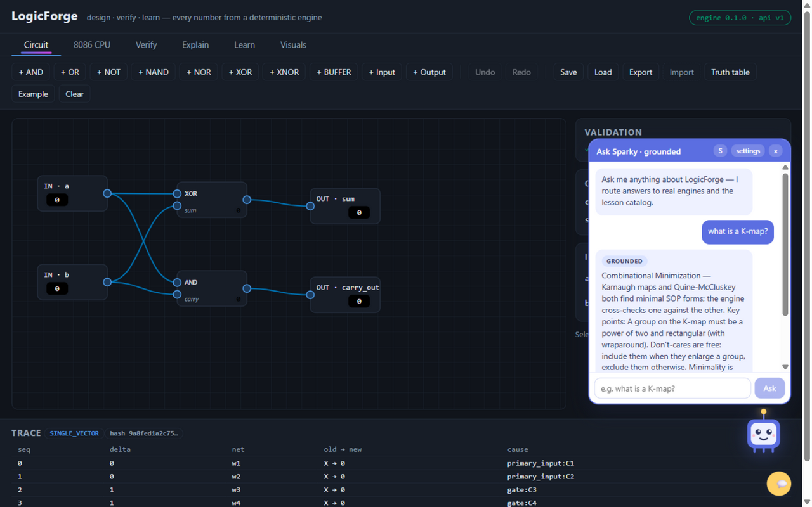
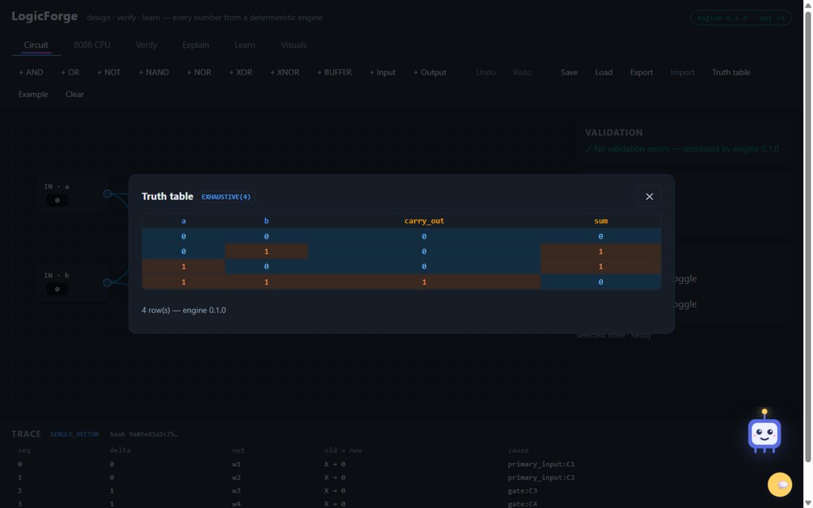
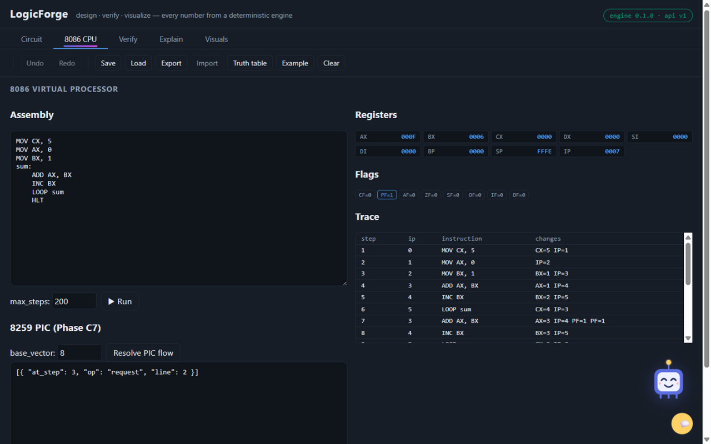
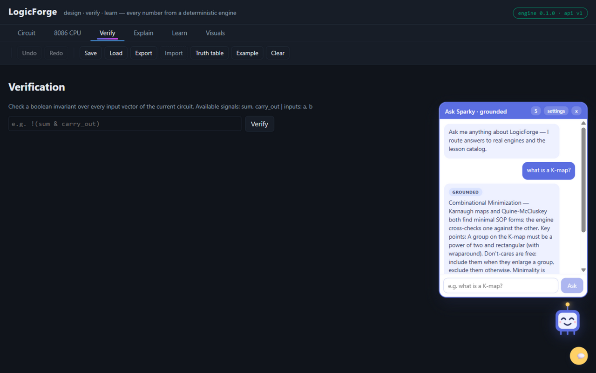
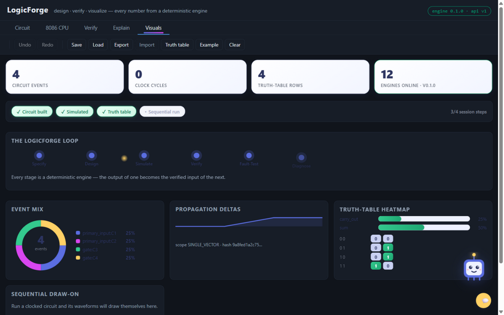
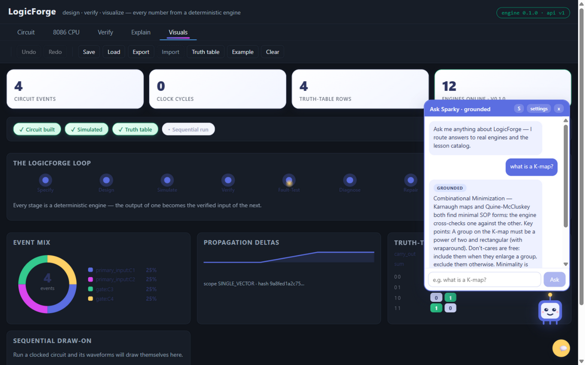

# LogicForge

<div align="center">
  

  **Design digital hardware. Drive an 8086. Get graded by real engines. Meet Sparky.**

  [](https://github.com/Avani376/LogicForce/actions/workflows/ci.yml)
  
  
  
  
</div>

---

## The 30-second pitch

LogicForge is a **self-verifying digital-system engineering platform**. You design
circuits on a canvas and 8086 assembly in an editor; twelve deterministic engines
simulate, verify, break, diagnose, repair, and optimize your work — and every single
result carries a **scope label** (`EXHAUSTIVE(k)`, `BOUNDED(k)`) plus a SHA-256 input
hash, so any claim can be replayed byte-for-byte. There is even a mascot: **Sparky**,
a chip-bot who guides you, celebrates your passes, and answers questions with answers
routed to real engine output — never invented.

## The problem → the solution

**The problem.** Digital-logic students and junior engineers practice on tools that
give them *answers without evidence*. A simulator says "output = 1" but not why. A
"fix" is accepted because it looks plausible. And modern AI tutors happily
hallucinate gate behavior, fake counterexamples, and invented timing numbers.

**The solution.** LogicForge inverts the trust model:

| Common tool behavior | LogicForge behavior |
|---|---|
| Simulation with no provenance | Every run emits an ordered **trace** and a SHA-256 `input_hash` — same inputs ⇒ byte-identical replay, enforced by 100× replay tests |
| "It's fixed" | A repair is only accepted after **re-verification against the full property suite** |
| Optimizations "that should be equivalent" | Every rewrite ships **exhaustive equivalence evidence** — the truth table is provably unchanged |
| AI tutors that invent results | The assistant **refuses to explain without engine evidence** and labels every answer `⚙️ grounded` or `🧠 generative` |
| Vague correctness claims | Results carry honest **scope labels**: `EXHAUSTIVE(k)`, `BOUNDED(k)`, `INCOMPLETE` |

Contracts are written **before** code (`docs/semantics/` — 13 normative documents),
and tests check the code against them. That discipline is the product.

## The workspace — five tabs, one glance

<div align="center">

</div>

### ⚡ Circuit studio — design + simulate
Drag-and-drop gate canvas (AND, OR, XOR, NAND, NOR, NOT, buffers, constants, D/T/JK/SR
flip-flops, registers, counters), click-to-wire with live output probes, **complete
non-fail-fast validation** (typed error codes, not just the first error), and a
topological simulator that records every value change in emission order. The truth
table is exhaustive up to 12 inputs.

<div align="center">

</div>

### 🔬 Verify — proofs, not vibes
Write invariants (`!(north_green & east_green)`) and check them over the **full truth
table or the entire FSM firing space**. Failures return a **replayable counterexample**
— a concrete input sequence that reproduces the violation. The faulty traffic-light
controller is an automated acceptance test: detected, diagnosed, repaired, re-verified.

### 💥 Faults → diagnosis → repair → optimize
Seed stuck-at/bridge faults into any circuit, probe behavior, and get a detection
report naming affected components. The repair engine proposes candidate fixes by
guided deltas — then **re-verifies every candidate** before claiming success. The
optimizer (double-negation removal, buffer elimination, constant folding, dead-gate
pruning, duplicate merging) improves metrics only while an equivalence check proves
behavior is untouched.

### 🖥️ 8086 CPU — the real syllabus, executed
A full educational instruction set: MOV/XCHG, the ALU family, INC/DEC/NEG,
**MUL/IMUL/DIV/IDIV** (exact flag semantics, truncating signed division), shifts and
rotates, **string ops with REP/REPE/REPNE and the DF flag**, PUSH/POP, jumps/LOOP/
CALL/RET, **software and hardware interrupts** (IVT, NMI/INTR with IF masking, IRET
restoring every flag), IN/OUT, and a **published-timing model**. Segmented 1 MiB
memory with mod-2²⁰ wraparound, stack, breakpoints, step/run, and a full trace.

<div align="center">

</div>

And the **8259 PIC** — IRR/ISR/IMR, the ICW/OCW programming state machine, fully-nested
priority with rotation, the whole EOI family — resolves scheduled line events into the
exact instruction boundaries at which each vector reaches the CPU:

<div align="center">

</div>

### 📊 Visuals — the session dashboard
Four count-up stat tiles, session-progress chips, an interactive **event-mix donut**,
a propagation-delta sparkline, truth-table **1-density bars** with the staggered
heatmap, and self-drawing waveforms. Everything renders from real engine output of
your session — empty charts say so instead of showing fake data.

<div align="center">

</div>

### 🤖 Sparky — the mascot with a conscience
Blinks, bobs, waves, celebrates with confetti, consoles failures, and guides you to
the next step. Its chat answers in two modes: **⚙️ grounded** (routed to the explain
engine or the lesson catalog) or **🧠 generative** — paste your own OpenAI-compatible
key and the model reasons deeply *on top of the same engine facts*, because the
deterministic router's output is injected into its prompt. The key lives in your
browser's localStorage only, and generative replies are always labeled. No key?
Grounded mode still works — and the assistant will tell you, honestly, when it can't
ground an answer.

<div align="center">

</div>

## Architecture in one look

```
apps/web (React + Vite)  ──/api──▶  apps/api (FastAPI, thin routers)
                                        │
                                        ▼
      engines/logic · sequential · verify · faults · repair · optimize
      cpu8086 · cosim · numsys · boolean · pic8259 · curriculum
                                        │
                                        ▼
                docs/semantics/*.md — contracts written BEFORE the code
```

Every engine is a pure, installable package: no wall-clock, no randomness, no I/O.
Typed `LogicEngineError` subclasses cross the API as structured 4xx envelopes —
failures are never silent and never stringly-typed.

## What the tests guarantee

- **909 tests**, coverage **≥ 90% enforced in CI** (currently 92%+)
- **Determinism**: 100× byte-identical trace replays per golden fixture
- **Cross-checks**: simulator vs an independent naive evaluator (hypothesis),
  K-map vs Quine-McCluskey agreement, flag vectors pinned to the Intel manual
- **A live API probe** (`scripts/live_api_probe.py`) — 33 checks against a running
  server, all green, including hostile inputs (divide-by-zero, malformed PIC words,
  unparseable submissions)

## Run it locally — 60 seconds

```bash
git clone https://github.com/Avani376/LogicForce.git && cd LogicForce

# backend
python -m venv .venv && source .venv/Scripts/activate   # Windows Git Bash
pip install -r requirements.txt && pip install -e .
uvicorn logicforge_api.main:app --port 8000

# frontend (second terminal)
cd apps/web && npm install && npm run dev   # → http://localhost:5173
```

Or with Docker: `docker compose up --build` → API on :8000, UI on :80.

## Documentation

| Doc | What's inside |
|---|---|
| [`CONTRIBUTING.md`](CONTRIBUTING.md) | setup, the two non-negotiable rules, how to add anything |
| [`docs/PROJECT_CONTEXT.md`](docs/PROJECT_CONTEXT.md) | honest current state, non-obvious internals, open work |
| [`docs/API.md`](docs/API.md) | all 21 endpoints with contracts and error envelopes |
| [`docs/semantics/`](docs/semantics/) | 13 normative engine contracts (written before code) |
| [`docs/WALKTHROUGH.md`](docs/WALKTHROUGH.md) | scene-by-scene video-recording script |
| [`docs/COURSE_REPORT.md`](docs/COURSE_REPORT.md) · [`docs/syllabus-map.md`](docs/syllabus-map.md) | course deliverable + per-item traceability |

## Roadmap

Persistence & auth (deliberately deferred — needs a D5 design decision), FSM
state-graph view, cascade multi-PIC, per-iteration REP timing. See
[`docs/PROJECT_CONTEXT.md`](docs/PROJECT_CONTEXT.md) for the shortlist and
[`CONTRIBUTING.md`](CONTRIBUTING.md) for how to claim one.

---

<div align="center">
  
</div>

<div align="center">
  <sub>Built as a serious engineering product: deterministic engines, honest claims, and one very proud chip-bot. ⚡</sub>
</div>
