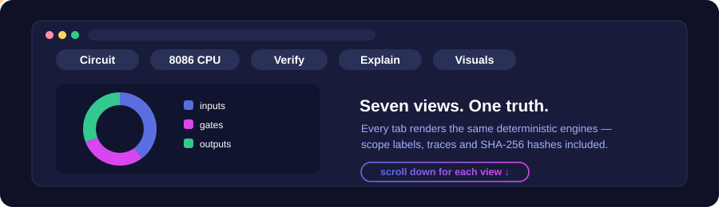
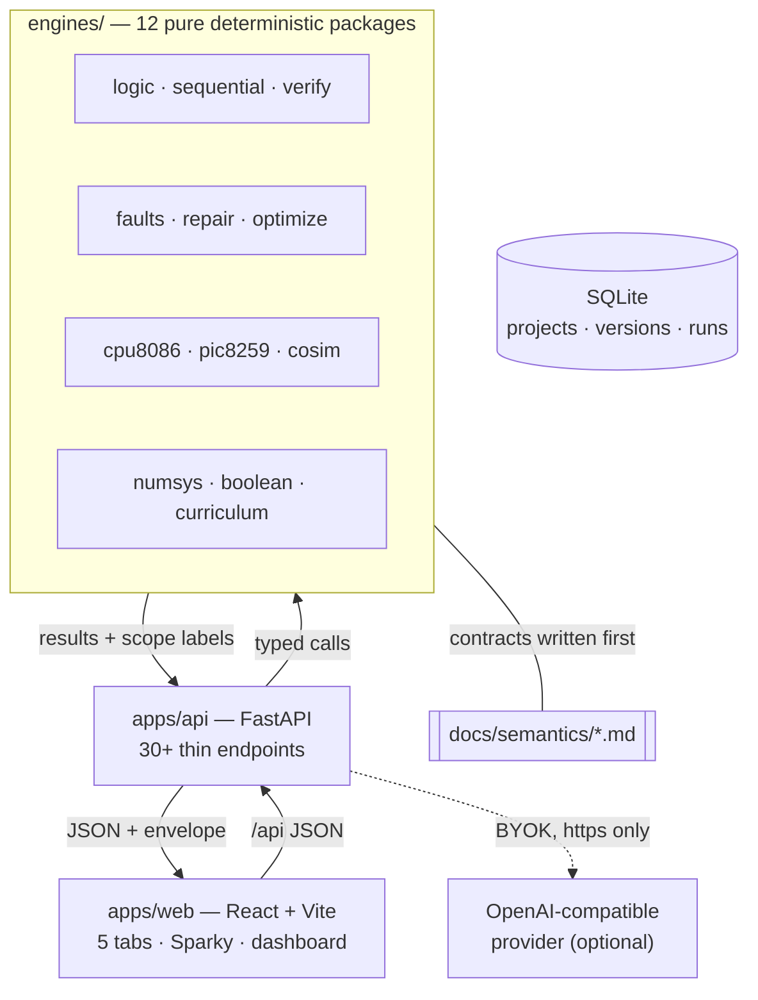

# LogicForge

<div align="center">
  

  **A self-verifying digital-system engineering platform — every result computed by a deterministic engine and labeled with its verification scope.**

  [](https://github.com/Avani376/LogicForce/actions/workflows/ci.yml)
  
  
  
  
  [](#license)

  [Overview](#overview) · [Features](#features) · [Architecture](#architecture) · [Getting Started](#getting-started) · [Testing](#testing) · [Documentation](#documentation) · [Contributing](#contributing)
</div>

---

## Overview

LogicForge is a web-based engineering workspace for digital-system design and analysis.
You design circuits on a visual canvas and write 8086 assembly in an editor; twelve
deterministic engines simulate, verify, break, diagnose, repair, and optimize your work.

Every result carries a **scope label** (`EXHAUSTIVE(k)`, `BOUNDED(k)`, `INCOMPLETE`) and a
SHA-256 input hash, so any claim can be replayed byte-for-byte. The platform enforces one
rule above all others: **the engines are the single source of truth**. The UI renders
engine output. The AI assistant routes questions to real engine results. Nothing in the
stack invents a simulation result, a verification verdict, or a number.

## The problem

Digital-logic students and junior engineers practice on tools that produce answers
without evidence:

- Simulators say "output = 1" but not *why*.
- "Fixes" are accepted because they look plausible — no one re-checks the original properties.
- AI tutors hallucinate gate behavior, fake counterexamples, and invented timing numbers.
- Optimization claims "should be equivalent" without proof.

LogicForge addresses each of these with a specific mechanism (see
[Engineering guarantees](#engineering-guarantees)).

## Features

<div align="center">
  
</div>

### Circuit studio — design + simulate

Drag-and-drop gate canvas (AND, OR, XOR, NAND, NOR, NOT, buffers, constants, D/T/JK/SR
flip-flops, registers, counters), click-to-wire with live output probes, complete
non-fail-fast validation (typed error codes — not just the first error), and a
topological simulator that records every value change in emission order. The truth
table is exhaustive up to 12 inputs.

### Verify — proofs, not vibes

Write boolean invariants (`!(north_green & east_green)`) and check them over the full
truth table or the entire FSM firing space. Failures return a **replayable
counterexample** — a concrete input sequence that reproduces the violation. The faulty
traffic-light controller is an automated acceptance test: detected, diagnosed, repaired,
re-verified.

### Faults → diagnosis → repair → optimize

Seed stuck-at faults into any circuit, probe behavior, and get a detection report
naming affected components. The repair engine proposes candidate fixes by guided
deltas — then re-verifies every candidate against the full property suite before
claiming success. The optimizer (double-negation removal, buffer elimination, constant
folding, dead-gate pruning, duplicate merging) improves metrics only while an
equivalence check proves behavior is unchanged.

### 8086 CPU — the real syllabus, executed

A full educational instruction set: MOV/XCHG, the ALU family, INC/DEC/NEG,
MUL/IMUL/DIV/IDIV (exact flag semantics, truncating signed division), shifts and
rotates, string ops with REP/REPE/REPNE and the DF flag, PUSH/POP, jumps/LOOP/CALL/RET,
software and hardware interrupts (IVT, NMI/INTR with IF masking, IRET restoring every
flag), IN/OUT, and a published-timing model. Segmented 1 MiB memory with mod-2²⁰
wraparound. The debugger provides breakpoints, step/run, register/flag grids, a memory
snapshot viewer, and a stack window at SS:SP.

The **8259 PIC** — IRR/ISR/IMR, the ICW/OCW programming state machine, fully-nested
priority with rotation, the whole EOI family — resolves scheduled line events into the
exact instruction boundaries at which each vector reaches the CPU.

### FSM lab — see the machine

Paste any state machine and the state graph draws itself: circular layout, self-loops,
transition-labeled arrows, initial-state marker. Simulate an input sequence for a
per-cycle table, or run the reachability check — states no input sequence can reach are
dimmed. Simulated paths highlight traversed edges in green.

### Fault diagnosis dashboard

Paste a batch of faults as a JSON array, run them all, and get a coverage report:
percentage detected, per-fault DETECTED/ESCAPED verdicts, and first-divergence details.
The repair search proposes candidates and re-verifies each against the property suite.

### Visuals — the session dashboard

Count-up stat tiles, session-progress chips, an interactive event-mix donut, a
propagation-delta sparkline, truth-table heatmaps with 1-density bars, and draw-on
waveforms. Every chart renders from real engine output of your session — empty charts
say so instead of showing fabricated data.

### Sparky — the AI assistant that can't lie

Blinks, bobs, waves, celebrates your passes, consoles your failures, and guides you to
the next step. Its chat answers in two modes:

- **Grounded** (default) — routes questions to the explain engine or the lesson
  catalog. Cites real trace steps or curriculum content.
- **Generative** (optional) — paste your own OpenAI-compatible API key in Sparky's
  settings and the model reasons deeply *on top of the same engine facts*. The
  deterministic router's output is injected into its prompt first. Responses are
  labeled generative so you know what produced them.

The key lives in your browser's localStorage only — never stored server-side. Without
a key, grounded mode still works. The assistant will tell you, honestly, when it
cannot ground an answer.

### Persistence — save, version, restore

Projects, version snapshots, and run history are stored server-side in SQLite (stdlib
`sqlite3`, WAL mode, zero new dependencies). Optional bearer-token auth protects write
endpoints when `LOGICFORGE_AUTH_TOKEN` is configured. Health checks report the
database path and auth status.

## Architecture

<div align="center">



</div>

**Follow one request through the diagram** — pressing Run in the 8086 tab:

1. **Client** — `Cpu8086Panel` POSTs the source, IVT, schedule, and step cap to
   `/api/8086/run`. The UI never simulates anything itself.
2. **API lane** — the router validates the request shape (Pydantic), resolves the
   IVT labels through the assembler, and hands the program to the `cpu8086` engine.
   Any typed `LogicEngineError` becomes a structured 4xx envelope — never a silent default.
3. **Engine lane** — the executor walks the instruction subset step by step, firing
   scheduled interrupts at instruction boundaries and recording every register/flag/
   memory delta into a trace.
4. **Back up the lanes** — the response carries `stop_reason`, the full trace, and
   the engine version. Same request + same engine version = byte-identical body.
5. **The contracts bar** — every behavior above is pinned by a document in
   `docs/semantics/` written before the code, and the test suite enforces that the
   code never drifts from it.

The dashed violet path is the one place an external service appears: Sparky's optional
generative mode. Even there, the deterministic router's answer and your engine evidence
are injected into the prompt first — the provider extends grounded facts, it does not
replace them.

## Getting started

### Prerequisites

- Python 3.12+
- Node.js 20+ and npm

### Local setup (all platforms)

```bash
# 1. Clone
git clone https://github.com/Avani376/LogicForce.git
cd LogicForce

# 2. Backend
python -m venv .venv
# Windows (Git Bash):
source .venv/Scripts/activate
# Linux/macOS:
# source .venv/bin/activate
pip install -r requirements.txt -r requirements-dev.txt
pip install -e .

# 3. Frontend (second terminal, or after activating the venv)
cd apps/web && npm install && npm run dev
# → http://localhost:5173 (proxies /api to :8000)
```

The API serves interactive docs at `http://localhost:8000/docs` (OpenAPI/Swagger).

### Docker

```bash
docker compose up --build
# API on http://localhost:8000 · UI on http://localhost:80
```

Two images are built: `Dockerfile.api` (FastAPI only, non-root user, health check) and
`Dockerfile.web` (nginx serving the built frontend, proxying `/api` to the API service).

For a **single-container deployment** (UI + API in one process, one origin):

```bash
docker build -f Dockerfile.full -t logicforge .
docker run -p 8000:8000 logicforge
# → http://localhost:8000 serves both the UI and the API
```

### Public deployment (Render)

<div align="center">

[](https://render.com/deploy?repo=https://github.com/Avani376/LogicForce)

</div>

The repo ships a `render.yaml` Blueprint — click the button above, connect your
GitHub account, and Render builds the single-origin image automatically.

1. Click **Deploy to Render** (or go to [render.com](https://render.com), sign in with
   GitHub, then **New → Blueprint** → select `Avani376/LogicForce`).
2. **Apply** — Render builds the single-origin image and publishes a public HTTPS URL
   once `/api/health` passes.

### Environment variables

| Variable | Default | Purpose |
|---|---|---|
| `LOGICFORGE_DB` | `./logicforge.db` | SQLite database file path |
| `LOGICFORGE_AUTH_TOKEN` | *(unset)* | Bearer token for write endpoints; unset = single-user local mode |
| `LOGICFORGE_RATE_LIMIT` | `240` | Global requests/min per client IP (`off` to disable) |
| `LOGICFORGE_ASSISTANT_RATE_LIMIT` | `30` | Assistant requests/min per client IP |
| `LOGICFORGE_MAX_BODY_BYTES` | `1048576` | Maximum request body size (1 MiB) |
| `LOGICFORGE_LOG_FORMAT` | `text` | `json` for structured JSON log lines |
| `LOGICFORGE_LOG_LEVEL` | `INFO` | Logging level |
| `LOGICFORGE_AI_API_KEY` | *(unset)* | Server-side AI key for the generative chat layer |
| `LOGICFORGE_AI_BASE_URL` | `https://api.openai.com/v1` | OpenAI-compatible provider URL (https, public hosts only) |
| `LOGICFORGE_BACKUP_DIR` | `./backups` | Directory for database backup snapshots |

## Testing

```bash
# Full suite with coverage gate (≥ 90% enforced)
pytest --cov --cov-fail-under=90

# Lint and type check
ruff check .
ruff format --check .
mypy engines/logic/logic_engine engines/sequential/sequential_engine \
     engines/verify/verify_engine engines/faults/fault_engine \
     engines/repair/repair_engine engines/optimize/optimize_engine \
     engines/cpu8086/cpu8086 engines/cosim/cosim_engine engines/numsys/numsys \
     engines/boolean/boolean_engine engines/pic8259/pic8259 \
     engines/curriculum/curriculum_engine apps/api/logicforge_api

# Frontend build (includes TypeScript check)
cd apps/web && npm run build
```

CI runs all of the above on every push, plus:

- **Engine boundary validation** — 10 probes covering IDIV/DIV overflow boundaries,
  backward MOVSW, PIC rotate-EOI delivery, X-propagation
- **Live API E2E probe** — 33 checks against a real uvicorn server, including hostile
  inputs (divide-by-zero, malformed PIC words, unparseable submissions)
- **Browser E2E** — Playwright tests across all 7 workspace tabs (real user workflows)
- **Security scan** — `pip-audit` + `npm audit`
- **Docker build + smoke test** — all three images built and health-checked

## Engineering guarantees

| Guarantee | Mechanism |
|---|---|
| Determinism | No wall-clock, no randomness, no I/O inside `engines/*`. 100× byte-identical replay tests per golden fixture |
| Honest scope labels | Every result carries `EXHAUSTIVE(k)` / `BOUNDED(k)` / `INCOMPLETE` — you always know how strong a claim is |
| Contracts before code | 18 documents in `docs/semantics/` written before the corresponding engine code; tests enforce agreement |
| Failures speak | Typed `LogicEngineError` subclasses with structured 4xx envelopes; counterexamples are replayable input sequences |
| Repairs are proven | Every repair candidate must pass the full property suite; optimization must pass exhaustive equivalence |
| AI cannot invent | The assistant routes questions to real engine output or the lesson catalog. Without evidence it refuses to answer. Generative mode injects engine facts into the prompt and labels the response |

## Project structure

```
├── apps/
│   ├── api/                  FastAPI service (thin routers, engines do the work)
│   │   ├── logicforge_api/
│   │   │   ├── main.py       App factory + middleware
│   │   │   ├── persistence.py  SQLite layer (stdlib sqlite3, WAL)
│   │   │   ├── auth.py       Bearer-token auth for writes
│   │   │   ├── hardening.py  Rate limits + body-size cap
│   │   │   ├── assistant.py  Grounded Q&A router
│   │   │   ├── assistant_chat.py  BYOK generative layer
│   │   │   ├── logging_setup.py  JSON/human log formatter
│   │   │   └── routers/      One file per domain
│   └── web/                  React + Vite workspace
│       ├── src/components/   One component per tab + shared
│       ├── src/lib/          API client + sound engine
│       ├── e2e/              Playwright specs
│       └── playwright.config.ts
├── engines/                  12 pure deterministic packages
│   ├── logic/logic_engine/
│   ├── sequential/sequential_engine/
│   ├── verify/verify_engine/
│   ├── faults/fault_engine/
│   ├── repair/repair_engine/
│   ├── optimize/optimize_engine/
│   ├── cpu8086/cpu8086/
│   ├── cosim/cosim_engine/
│   ├── numsys/numsys/
│   ├── boolean/boolean_engine/
│   ├── pic8259/pic8259/
│   └── curriculum/curriculum_engine/
├── tests/                    unit · golden · property · integration · per-engine
├── docs/
│   ├── semantics/            18 normative contracts (written before code)
│   ├── assets/               Animated SVGs + screenshots
│   └── *.md                  Architecture, API, testing, deployment, roadmap…
├── scripts/                  Live API probe, engine validation, fixture generators
├── Dockerfile.api            FastAPI-only image (non-root, health check)
├── Dockerfile.full           Single-origin image (UI + API in one process)
├── Dockerfile.web            nginx serving the built frontend
├── docker-compose.yml        api + web with restart policies
└── render.yaml               Render Blueprint for one-click public deployment
```

## Documentation

| Document | Content |
|---|---|
| [`CONTRIBUTING.md`](CONTRIBUTING.md) | Setup, the two non-negotiable rules, how to add engines/endpoints/tests |
| [`docs/PROJECT_CONTEXT.md`](docs/PROJECT_CONTEXT.md) | Honest current state, non-obvious internals, open work |
| [`docs/API.md`](docs/API.md) | All implemented endpoints with request/response contracts |
| [`docs/semantics/`](docs/semantics/) | 18 normative engine contracts |
| [`docs/ARCHITECTURE.md`](docs/ARCHITECTURE.md) | Architecture principles and module responsibilities |
| [`docs/TESTING.md`](docs/TESTING.md) | Test strategy and category breakdown |
| [`docs/DEPLOYMENT.md`](docs/DEPLOYMENT.md) | Docker, Render Blueprint, production checklist, hardening defaults |
| [`docs/LIMITATIONS.md`](docs/LIMITATIONS.md) | What the platform cannot do (the anti-overclaim contract) |
| [`docs/ENGINEERING_DECISIONS.md`](docs/ENGINEERING_DECISIONS.md) | Decision log with rationale |
| [`docs/WALKTHROUGH.md`](docs/WALKTHROUGH.md) | Scene-by-scene video-recording script |
| [`docs/VERIFICATION_MODEL.md`](docs/VERIFICATION_MODEL.md) | Scope labels, verdict rules |
| [`docs/COURSE_REPORT.md`](docs/COURSE_REPORT.md) | Course deliverable |
| [`docs/syllabus-map.md`](docs/syllabus-map.md) | Per-item syllabus traceability |

## Current status

**Implemented and tested** — all 12 engines, 30+ API endpoints, 7-tab workspace,
984 tests (92% coverage), full 8086 instruction subset, 8259 PIC, SQLite persistence,
grounded AI assistant with optional generative mode, Playwright browser E2E, Docker
deployment, CI with 5 jobs.

**Known limitations** (see [`docs/LIMITATIONS.md`](docs/LIMITATIONS.md)):

- No authentication for multi-user access (single-user local mode by default;
  optional bearer token for shared deployments)
- No cloud storage — SQLite file on the server disk
- PIC cascade (multi-chip) not simulated
- REP string ops execute as one step (per-iteration timing not modeled)
- Poll mode (OCW3 P=1) rejected

## Roadmap

| Item | Status | Notes |
|---|---|---|
| FSM invariant editing inside the graph panel | Backend exists; UI pending | |
| 8086 disassembly view | Not started | |
| Multi-project collaboration | Needs auth backend design | |
| Cascade multi-PIC | Contract-declared out of scope | Design first |
| Per-iteration REP timing | Contract amendment needed | |

See [`docs/PROJECT_CONTEXT.md`](docs/PROJECT_CONTEXT.md) for the full shortlist and
[`CONTRIBUTING.md`](CONTRIBUTING.md) for how to claim one.

## Contributing

1. Read [`CONTRIBUTING.md`](CONTRIBUTING.md) — especially the two non-negotiable rules
   (deterministic engines, contracts before code).
2. Pick an item from the roadmap or open an issue.
3. Create a feature branch, implement with tests, run the full gate suite.
4. Submit a pull request — CI runs lint, types, tests, E2E, security, and Docker.

## License

[MIT](LICENSE)

## Acknowledgements

Built as a serious engineering product by
[Avani Jannawar](https://github.com/Avani376) — VIT, Semester 3. The 8259 PIC model,
8086 flag semantics, and QM algorithm are implementations of publicly documented
specifications (Intel manuals, standard algorithms).

---

<div align="center">
  
</div>

<div align="center">
  <sub>Deterministic engines. Honest claims. One very proud chip-bot.</sub>
</div>
